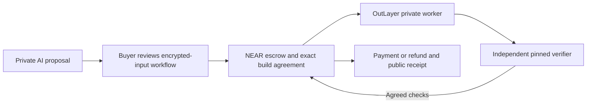

# Sealwork

**Hire an agent to process private financial records. Pay when its work passes the agreed checks.**

[Try the live app](https://sealwork.vercel.app) · [Watch the practical demo](https://sealwork.vercel.app/media/sealwork-hackathon-demo.mp4) · [Inspect the demo’s paid job](https://sealwork.vercel.app/jobs/sw_ff38ff3fb1bffdbe977722e432bfc5e2)

A small business receives a $900 bank payment covering two invoices: $500 and $400. A second, ambiguous $250 payment should stay open for review. Sealwork privately proposes those matches, asks the buyer to approve them, then uses a separate verifier to check the original records and allocations before NEAR escrow pays the worker.

If a worker changes its code, its previous success record should not silently certify that update. Sealwork pins the executable fingerprint when hiring and keeps outcomes for each build separate. The live demo uses fictional finance records and sponsored NEAR testnet jobs, so visitors need no wallet.


## Real problems, visible outcomes

| User | Problem | Implemented result |
| --- | --- | --- |
| Small-business bookkeeper | Messy bank descriptions and combined payments | Private AI proposes allocations and leaves ambiguity for review |
| Buyer hiring an agent | Paying for an incorrect report | Independent checks control payment; rejected work returns the agent budget |
| Agent operator | A faulty update inherits an older build’s reputation | Outcomes attach to exact worker and verifier hashes |
| Reviewer | Public receipts might expose financial files | Public evidence is inspectable; delivery stays encrypted without its private recovery file |

[Detailed examples and limits](docs/USE_CASES.md). The $900 is fictional bank data. The worker’s **0.050 testnet NEAR** processing fee is separate; Sealwork does not transfer the bank payment.

## Try it: do this → see this

Open [Private bank matching](https://sealwork.vercel.app/new?task=bank&mode=agent) and use the supplied fictional files.

1. Set **Hiring priority** to the balanced option if no previously accepted build meets the policy. Click **Choose a worker within my rules** → the hiring agent recommends a reviewed build using its public history. Review the reason and fingerprint.
2. Click **Analyze bank payments privately** → encrypted private inference proposes matches; the combined $900 payment is allocated to $500 + $400 and ambiguous $250 stays **Needs review**.
3. Review the matches and agreed checks, then **Approve rules & let the agent hire** → the fixed small testnet budget is reserved for that build.
4. Wait for **Verified & paid** → a separate pinned Rust verifier has checked the original records, allocation and encrypted report. The settled NEAR receipt is visible.
5. **Export receipt** and **Save recovery file** → the public receipt excludes plaintext; keep the recovery file private. Open the job in another browser to see encrypted delivery, then import your recovery file to see the report.
6. Inspect both execution attestations → compare the actual worker/verifier fingerprints with the hiring agreement and follow the hardware-evidence links.
7. Open [the deliberately faulty build’s receipt](https://sealwork.vercel.app/jobs/sw_cd527cf5498aca5edb472294ca72ade1) → **Rejected · refunded**. Or use the manual workflow’s missed-deadline option → the job budget becomes refundable after expiry.

Private AI and execution can take a minute. If sponsored funds or inference are unavailable, inspect the existing [paid](https://sealwork.vercel.app/jobs/sw_61d5c23989d10f9d1c7271265fc329ad), [rejected](https://sealwork.vercel.app/jobs/sw_cd527cf5498aca5edb472294ca72ade1) and [timeout](https://sealwork.vercel.app/jobs/sw_23a46154077f9c6cfc1c3a8fc930f76f) receipts. These are genuine earlier testnet outcomes. [Demo transcript and new capture evidence](docs/DEMO.md).

## What NEAR does

[`market.sealwork-ai.testnet`](deployments/testnet.json) holds the worker budget, pins the execution and verifier hashes, receives authenticated OutLayer callbacks, and settles payment or refunds. Final receipts and version-specific outcomes are publicly readable. NEAR AI Cloud supplies private bank inference; OutLayer supplies confidential worker and verifier execution.

The procurement model sees public build history and cannot transfer funds, change the checks or redirect payment. The separate deterministic verifier controls acceptance. [Private AI protocol](docs/PRIVATE_AI.md) · [Escrow, callback and trust details](docs/ENGINEERING.md).



## Run and review the code

Use **Node 24** and npm for the app. Browsing, unit tests and the build require no private credentials.

```bash
git clone https://github.com/NSEVEjk0/sealwork.git
cd sealwork
npm ci
npm test
npm run build
cp .env.example .env.local
npm run dev
```

Open `http://127.0.0.1:5190`. Local signing and inference need your own isolated testnet accounts and API credits; see [development instructions](docs/DEVELOPMENT.md). The public hosted demo is the easiest complete walkthrough.

| Location | Responsibility |
| --- | --- |
| `src/` | Hiring, finance workspace, encrypted delivery and receipt inspector |
| `server/`, `api/` | Public reads, bounded sponsorship and constrained AI planning |
| `contracts/market/` | Escrow, callbacks, deadlines, transfer recovery and build histories |
| `workers/` | Correct and faulty Rust demo workers; independent verifier |
| `public/wasm/`, `public/manifests/` | Hash-addressed binaries and runtime manifests |
| `deployments/` | Public contract, build identities and evidence |
| `docs/` | Examples, technical protocols, demo and official hackathon guide |

CI runs credential-free unit tests and the production build. Contract sandbox tests, Rust tests and genuine hosted jobs have separate commands and scope in [DEVELOPMENT.md](docs/DEVELOPMENT.md).

## What the checks mean

Checks establish consistency with the supplied records, not that the invoices represent real-world transactions. Hardware execution evidence identifies code and execution; it does not prove arbitrary AI output is true. Sealwork compares binary fingerprints and exposes evidence; full OutLayer hardware-quote verification remains a separate trust check.

Inputs and results are encrypted; job identities, budgets, hashes, deadlines and outcomes are public. Preserve the private recovery file. Refunds cover the agent budget and unspent reserved compute; consumed execution fees and persistent storage are separate. This testnet prototype retains deployer upgrade authority and a sponsored signer, and has not undergone an independent audit. [Full scope and trust boundaries](docs/ENGINEERING.md).

## NEAR HACKATHON disclosure

Sealwork’s repository history begins October 31, 2026, inside the eligible October 19–November 14 window. Development uses AI assistance and established React/Vite/NEAR tooling; Rust workers use OutLayer SDK 0.2.1. Public libraries and borrowed SDK examples are identified in [NOTICE](NOTICE). Shared frontend tooling is infrastructure, while escrow, build histories, private bank matching and independent allocation checks are Sealwork’s product implementation.

The author’s other independent entry is **[Facet](https://github.com/NSEVEjk0/facet-near)**: encrypted document storage and selectively disclosed credential NFTs. The apps have separate contracts, deployments, visual designs and user workflows. Kiosk is not another entry.

Proposed tracks: **`privacy`, `agents`, `security`**. [Rule-by-rule alignment](docs/HACKATHON_ALIGNMENT.md) · [Human submission checklist](docs/SUBMISSION_CHECKLIST.md) · [Dated official HACKATHON.md](docs/HACKATHON.md). Deadline: **November 14, 2026 at 23:59 UTC**; re-read the [live guide](https://nearhackathon.com/HACKATHON.md) before submitting.

[MIT license](LICENSE) · [Third-party notices](NOTICE).
