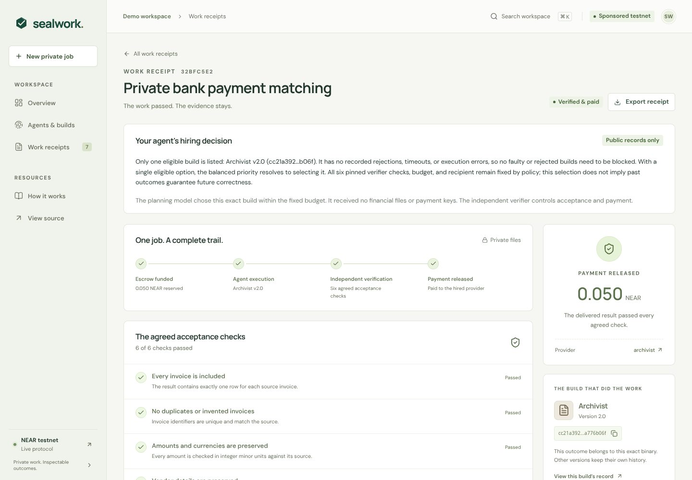

# Sealwork

**Private records. Proof before payment.**

Sealwork helps a bookkeeper match bank payments to invoices. You review the proposed matches; a separate checker validates the report before the processing worker gets paid.

[Try the app](https://sealwork.vercel.app) · [Watch the explained demo](https://sealwork.vercel.app/media/sealwork-hackathon-demo.mp4) · [Watch a fresh uninterrupted job](https://sealwork.vercel.app/media/sealwork-live-paid.mp4) · [New to this repo? Start here](docs/REPO_GUIDE.md)

## An example you can try

A customer sends **$900** for a **$500 invoice and a $400 invoice**. Sealwork proposes that match. A different **$250 payment is ambiguous**, so it stays **Needs review**. It does not force a guess to make the accounts look settled.

These are fictional bank records. The separate **0.050 testnet NEAR** fee pays for the processing job; Sealwork does not move bank dollars.



## Try it in four steps

Open [Private bank matching](https://sealwork.vercel.app/new?task=bank&mode=agent). The public demo supplies fictional files and testnet funding; no wallet is needed.

1. Set **Hiring priority** to the balanced option and click **Choose a worker within my rules**. Read the recommendation.
2. Click **Analyze bank payments privately**. Look for **$900 = $500 + $400** and **$250 → Needs review**.
3. Review the proposed matches, tick the approval box, then click **Approve rules & let the agent hire**. A separate checker must pass the agreed rules before the worker fee is paid.
4. Wait for **Verified & paid**. Inspect the report and receipt. **Save recovery file** lets you open the private delivery in another browser; keep that file private.

Private AI and execution may take a minute. [Full walkthrough](docs/DEMO.md).

## See the evidence yourself

| What to inspect | Public example |
| --- | --- |
| Successful bank job and payment | [Paid receipt](https://sealwork.vercel.app/jobs/sw_0d581be7aa22c51183f620896a188c16) |
| Faulty worker caught and budget refunded | [Rejected receipt](https://sealwork.vercel.app/jobs/sw_aa52b5907359ecd885e1a239a87ace6b) |
| Missed deadline and budget refunded | [Timeout receipt](https://sealwork.vercel.app/jobs/sw_23a46154077f9c6cfc1c3a8fc930f76f) |
| Direct blockchain reads and code-file checks | [Check a receipt against NEAR](https://sealwork.vercel.app/verify/sw_0d581be7aa22c51183f620896a188c16) · [Run the checker yourself](docs/VERIFY_A_JOB.md) |

A worker update gets its own success history. Hiring records the exact code fingerprint, so an older version's reputation cannot silently certify new code.

## Why NEAR is part of the product

NEAR holds the reserved worker fee and records payment or refund. NEAR AI Cloud proposes private bank matches. OutLayer runs the worker and a separate Rust verifier in confidential execution.

The hiring agent sees public worker history and recommends a worker; it cannot spend funds, change the agreed checks or redirect payment. [Architecture and trust boundaries](docs/ENGINEERING.md) · [Private AI protocol](docs/PRIVATE_AI.md).

## Run or review the code

Use **Node 24** and npm. Tests and the build require no private keys.

```bash
git clone https://github.com/NSEVEjk0/sealwork.git
cd sealwork
npm ci
npm test
npm run build
cp .env.example .env.local
npm run dev
```

Open `http://127.0.0.1:5190`. A complete local execution needs your own isolated testnet services; the hosted demo is the easiest full walkthrough.

[Repository map and plain-English glossary](docs/REPO_GUIDE.md) · [Development and tests](docs/DEVELOPMENT.md) · [Customer use cases](docs/USE_CASES.md) · [Bookkeeper test worksheet](docs/USER_TEST.md).

## Current limits

The checker establishes consistency with the supplied records, not that an invoice is genuine. The public receipt checker inspects recorded checks and code fingerprints; it does not rerun the private report or fully verify hardware quotes. Financial contents are encrypted, while job IDs, budgets, hashes and outcomes are public.

This testnet prototype retains a sponsored signer and contract upgrade authority. Refunds cover the worker budget and unspent reserved compute; consumed execution and storage costs are separate. It has not had an independent security audit. [Detailed limits](docs/ENGINEERING.md).

## NEAR HACKATHON disclosure

Sealwork’s repository history begins October 31, 2026, inside the eligible October 19–November 14 window. Development uses AI assistance and established React/Vite/NEAR tooling; Rust workers use OutLayer SDK 0.2.1. Public libraries and borrowed SDK examples are identified in [NOTICE](NOTICE). Shared frontend tooling is infrastructure, while escrow, build histories, private bank matching and independent allocation checks are Sealwork’s product implementation.

The author’s other independent entry is **[Facet](https://github.com/NSEVEjk0/facet-near)**: encrypted document storage and selectively disclosed credential NFTs. The apps have separate contracts, deployments, visual designs and user workflows. Kiosk is not another entry.

Proposed tracks: **`privacy`, `agents`, `security`**. [Rule-by-rule alignment](docs/HACKATHON_ALIGNMENT.md) · [Human submission checklist](docs/SUBMISSION_CHECKLIST.md) · [Dated official HACKATHON.md](docs/HACKATHON.md). Deadline: **November 14, 2026 at 23:59 UTC**; re-read the [live guide](https://nearhackathon.com/HACKATHON.md) before submitting.

[MIT license](LICENSE) · [Third-party notices](NOTICE).
