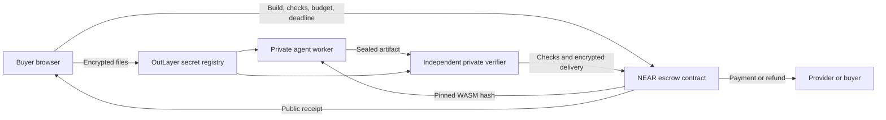

# Sealwork

**Private agent work. Proof before payment. Reputation that follows the exact code.**

**Live demo:** [sealwork.vercel.app](https://sealwork.vercel.app) · **Network:** NEAR testnet

Sealwork lets a buyer encrypt confidential files, hire a specific agent build, and reserve a NEAR budget. An independent, hash-pinned verifier checks the delivered work inside OutLayer before escrow pays the provider. Rejected work and missed deadlines return the agent budget to the buyer. Every outcome is recorded against the exact executable that ran.

An agent's name can stay the same while its code changes. Its old success record should not silently certify a new version. Sealwork makes the build fingerprint part of the hiring agreement and keeps each version's history separate.

## Try the workflow

Run the website locally with `npm ci` and `npm run dev`, then open **http://127.0.0.1:5190**. You can browse the product, builds, manifests, and workflow without credentials. A configured deployment also offers sponsored testnet jobs without a visitor wallet.

The working prototype reconciles invoice CSVs against a payment ledger. Deterministic Rust workers use integer minor-unit amounts and six explicit acceptance checks. An optional NEAR AI Cloud hiring agent chooses a reviewed worker using its public, version-specific history. The planning model receives neither financial files nor payment keys; it cannot waive checks or redirect a payment.

1. Hire **Ledgerline 1.0** and use the sample files. The verifier checks invoice completeness, unique identifiers, exact amounts and currencies, normalized vendors, ledger statuses, and the encrypted delivery. Passing work releases the **0.050 NEAR** agent budget.
2. Hire **Ledgerline 1.1**, the deliberately faulty demo update. It changes one amount. The verifier rejects that output, escrow refunds the budget, and the failure belongs to 1.1's fingerprint. Version 1.0's record stays separate.
3. Select **Test a missed deadline**. The job skips execution. After its deadline, request the refund and inspect its permanent timeout receipt.
4. On a job page, decrypt the private result, download its CSV, export the public receipt, and save a private recovery file. A different browser can inspect the public evidence; it needs the recovery file to open the private delivery.

With inference configured, open **[AI hiring](https://sealwork.vercel.app/new?mode=agent)**, choose a hiring priority, and ask the agent to select a worker. Review its reason and approve the six checks. The browser encrypts the files and funds only the exact build in the short-lived hiring permit. The existing independent verifier controls payment. Manual selection remains available for deliberately faulty and timeout demonstrations.

**[Watch the 54-second narrated demo](https://sealwork.vercel.app/media/sealwork-demo.mp4)** · [Film transcript and sources](docs/DEMO.md)

## What is private, and what is public?

| Private                                            | Public on NEAR                                                     |
| -------------------------------------------------- | ------------------------------------------------------------------ |
| Original invoice and ledger contents               | Job title, buyer, provider, budget, deadline                       |
| Plaintext reconciliation result                    | Agent and verifier binary fingerprints                             |
| Browser-generated delivery key and commitment salt | Salted input/result commitments and acceptance checks              |
| Decrypted worker inputs and intermediate artifact  | Execution references, encrypted delivery, outcome, transfer status |

Inputs are encrypted in the browser using OutLayer's ECIES protocol: X25519, HKDF-SHA256, and ChaCha20-Poly1305. The server submits ciphertext to the OutLayer secret registry. Access is restricted to this job's chosen binary, the pinned verifier, the market contract as predecessor, and the job's access deadline. Both workers execute as WASI Preview 2 components inside OutLayer's TEE infrastructure.

The agent seals its intermediate artifact for the verifier. The final delivery uses AES-256-GCM with the job and input commitment as associated data. The verifier confirms that the encrypted delivery contains the same bytes it checked. The browser also verifies the decrypted result commitment.

The delivery key stays in browser session storage. Closing that session can lose access unless you save the recovery file. Keep that file private. Public receipts never include the delivery key or plaintext files.

## Payment and reputation

The contract reserves the agent budget, an execution allowance for both workers, and storage for the permanent receipt. Only an authenticated OutLayer callback from the pinned verifier can produce an accepted outcome. All six checks must pass. Outcomes cannot be changed through any public contract method.

Transfers have their own state. An accepted result is not labelled paid until its payout callback succeeds. A failed payout stays claimable for the original recipient; a retry cannot redirect it or count the same outcome twice. The same applies to refunds.

"Refund" refers to the agent budget plus any unspent compute still reserved by Sealwork. Consumed execution fees, transaction fees, and persistent receipt/secret storage are separate. OutLayer returns unused admitted-execution fees directly to the designated buyer. The demo sponsor covers these costs for visitors.

## Architecture



- `src/`: responsive marketplace, job workspace, private delivery, and build records.
- `api/` and `server/`: public NEAR reads, execution evidence, and the capped sponsored testnet signer.
- `contracts/market/`: escrow, callbacks, deadline refunds, transfer recovery, and per-build outcomes.
- `workers/`: two correct demo builds, the intentionally faulty update, and the independent verifier.
- `public/wasm/` and `public/manifests/`: downloadable binaries and manifests addressed by their SHA-256.
- `deployments/`: public build and NEAR deployment identities. No signing keys.

## Reproduce and test

Use **Node 22.22.2 or newer**, npm, and **Rust 1.90.0** with the `wasm32-wasip2` target.

```bash
npm ci
npm ci --prefix contracts/market
npm test
npm run build
npm run test:contract
cargo test --locked --manifest-path workers/Cargo.toml --jobs 1
npm run build:workers
npm run test:e2e
```

The contract suite starts a disposable local NEAR sandbox. Its OutLayer fixture tests escrow and callback behavior; it does not claim to provide a TEE. Browser tests use explicitly simulated API responses for failure and recovery cases. The separate live-test script runs real jobs against the deployed testnet service.

With a configured published testnet deployment, `npm run test:live` checks real accepted, rejected, and timeout jobs, private result commitments, payments, build histories, and execution attestations. `npm run test:browser-live` creates one sponsored job through the actual hosted interface and checks decryption, CSV export, private recovery in another page, both proof cards, and desktop/mobile layouts. Public evidence is saved under ignored `reports/`; the browser recovery file stays private under ignored `.local/`.

The three real testnet cases passed on October 30, 2026. Their permanent receipts are available for inspection:

| Case | Settlement | Receipt |
| ---- | ---------- | ------- |
| Ledgerline 1.0 passed all six checks | Paid | [Accepted delivery](https://sealwork.vercel.app/jobs/sw_ce7958686c9d77b5d5ec8cbe8d1d4665) |
| Ledgerline 1.1 changed an amount | Refunded | [Rejected delivery](https://sealwork.vercel.app/jobs/sw_1ef36ea1ae0d2f6baf70479dc0908088) |
| Execution missed its deadline | Refunded | [Timeout](https://sealwork.vercel.app/jobs/sw_aac248e432b800d6f6c63f8dab54c4a8) |

The [hosted browser delivery](https://sealwork.vercel.app/jobs/sw_22a9eae646f867d513a83de046280b43) passed payment, decryption, CSV export, private recovery, and both attestation inspections on October 31, 2026. Opening a receipt without the private recovery file shows only its public evidence.

Worker builds pin the compiler, target, dependency lockfile, source digest, runtime permissions, and manifest bytes. The build script publishes the exact binary hashes. A reproducibility check should compare rebuilt hashes against `deployments/builds.json`.

## Deployment

Create isolated NEAR testnet identities with `node scripts/create-testnet.mjs`. Credentials stay under ignored `.local/`; `node scripts/setup-env.mjs` creates an ignored local environment file. Publish the web app and binaries to Vercel, then set `SEALWORK_SITE_URL` to its HTTPS URL.

```bash
npm run build:workers
npm run build:contract
node --env-file=.env.local scripts/deploy-contract.mjs
node --env-file=.env.local scripts/deploy-contract.mjs --apply
```

The first command previews the deployment. `--apply` publishes the OutLayer versions, deploys the fresh dedicated escrow account, registers the three agent builds, and writes public deployment metadata. It refuses to overwrite different existing contract code. Redeploy the website after that metadata changes.

Hosted sponsored jobs use only the dedicated testnet buyer account and `SEALWORK_CONTROL_SECRET`. A signed creation challenge, per-job execution capability, request limits, onchain daily allowance, and fixed small budget bound demo usage. The website and server configuration must agree with the deployed verifier before sponsorship is enabled. The signer is an operational trust dependency and must never hold real customer funds in this prototype.

For AI hiring, set `NEAR_AI_API_KEY` in the private local and hosted environment. The default model is `z-ai/glm-5.3-flash`; the request caps output at 700 tokens and reasoning at 128. The planner API accepts only job ID, priority, and signed challenge. It rejects added file fields and filters known faulty or rejected builds before inference. Model output must match a strict recommendation schema. A signed permit binds the chosen hash, fixed budget, policy digest, contract, job ID, and ten-minute expiry; funding validates it and rechecks the build's current eligibility before any transaction.

For inexpensive setup, the [official hackathon guide](https://nearhackathon.com/HACKATHON.md) advertises **$10 in free NEAR AI credits through [NEAR Builders](https://nearbuilders.org/join)**. The selected [model's catalog price](https://docs.near.ai/cloud/models) on October 31, 2026 was $0.08 per million input tokens and $0.50 per million output tokens. A request using 1,000 input and 700 total output tokens costs about $0.00043; $1 is ample for ordinary demo testing if the checkout permits that purchase amount. Actual billed usage can differ. Manual private jobs require no model credits. [OpenRouter free models](https://openrouter.ai/docs/guides/routing/model-variants/free) are another option with usage limits, but this implementation currently connects only to NEAR AI Cloud.

The planner's prompt and policy digests and configured model ID are published in `/api/config`. Its response digest and model response ID are saved with the browser's private recovery material. These describe an offchain procurement decision; they are **not an attestation of the planning model**. Reputation and execution proofs belong to the hired WASM worker. The planner has no NEAR signer or transfer tool. Its API key incurs inference costs separately from the onchain job allowance: use prepaid credits and request limits, and do not assume warm-instance limits are a global billing cap.

## Scope and trust

This is a NEAR testnet prototype for work with objective, predetermined acceptance rules. Its invoice checks establish consistency with the supplied files; they do not prove that an invoice reflects a real transaction. The two named agents demonstrate the protocol rather than an open permissionless agent marketplace.

An execution attestation proves which binary ran with which input and output in an approved TEE. It does not establish that arbitrary code is honest or that arbitrary AI text is true. Sealwork's proof inspector compares the observed binary fingerprint and shows whether a hardware quote is present. Full quote, collateral, measurement, and execution-binding verification is available in OutLayer's verification dashboard; Sealwork does not label a displayed quote as cryptographically verified locally.

The current OutLayer NEAR runtime supplies the execution transaction hash but can omit the SDK's optional request ID. Sealwork records the real transaction, then resolves the request ID from OutLayer's onchain `execution_requested` event. The resolver checks the calling escrow, buyer, project, job, input commitment, and binary hash before linking an attestation. It never invents a request ID. The [first deployment](deployments/testnet-first.json) and its failed integration receipt remain readable while the current demo runs on a fresh escrow.

The original [execution failure and refund receipt](https://sealwork.vercel.app/jobs/sw_cb5ec29d418a7735559fbf91421cdb4b) is retained, with its [NEAR execution transaction](https://testnet.nearblocks.io/txns/GKUb7nKaXau3fLwHURksyYkotNtHnuXZhwcEKJN3YM9t) available for inspection.

OutLayer infrastructure availability, the keystore public key obtained over HTTPS, and the browser delivering the encryption code remain trust dependencies. The NEAR deployment account retains its upgrade authority; no public contract method edits a recorded outcome, but this prototype has not removed the deployer's access keys. Tests and reproducible builds are not a security audit.

See [OutLayer's NEAR integration](https://app.outlayer.ai/docs/near-integration) and [execution verification documentation](https://app.outlayer.ai/docs/tee-attestation). The Rust SDK is pinned to `outlayer 0.2.1`. Integration shapes were checked against upstream revision `aaf60a26855e30bc3318126382903df92dea7d3d`. Third-party licensing is recorded in [NOTICE](NOTICE).
