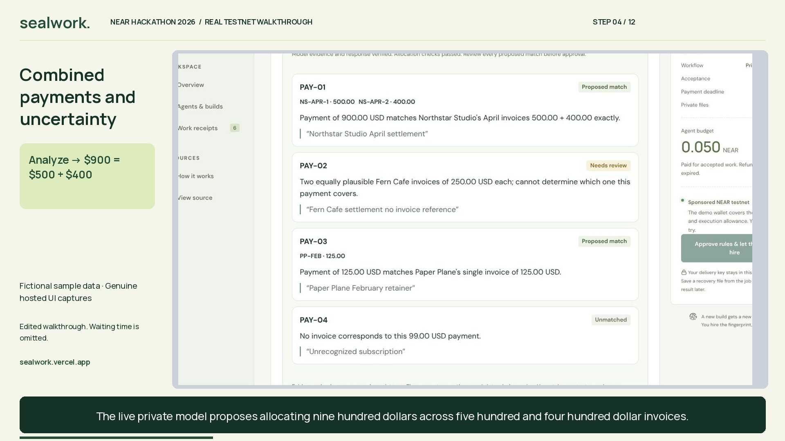

# Sealwork

**Match receipts. Review exceptions. Export checked balances.**

Sealwork helps a bookkeeper reconcile private bank receipts against invoices. It suggests combined and exact matches, keeps ambiguity visible, and lets the bookkeeper correct allocations before approving a confidential report. A separate verifier checks the result before the processing worker earns its reserved NEAR fee.

[Open the app](https://sealwork-next.vercel.app/new?task=bank) · [Watch the narrated workflow demo](https://sealwork-next.vercel.app/media/sealwork-hackathon-demo.mp4)

[](https://sealwork-next.vercel.app/media/sealwork-hackathon-demo.mp4)

The video introduces private processing and verification. Try the live sample for allocation review, balances and exports.

## Try a complete batch

The sample invoices and receipts are fictional. The $900/$250/$125/$99 records are accounting inputs; Sealwork does not transfer bank dollars. A separate 0.050 testnet NEAR fee pays the processing worker.

1. Open **Reconcile a sample batch** and click **Suggest exact matches locally**. PAY-01 should allocate $500 + $400. PAY-02 should show **Needs review**; PAY-04 stays unmatched. Alternatively use **Analyze bank payments privately** for NEAR AI suggestions.
2. Open the review queue. Resolve PAY-02 only if you can justify the intended invoice; enter a reason and apply. Or keep it unresolved. Currency totals show what remains unallocated. Editing clears final approval.
3. Choose the Ledgerline 3.0 worker, review the checks and approve the reviewed batch. Fund the sponsored testnet job. Wait for **Verified & paid**.
4. Download the invoice CSV, bank-receipt CSV and private reconciliation pack. Invoice rows include allocated/outstanding balances; receipt rows include unresolved amounts. Source fingerprints and reviewed-proposal provenance are inside the private pack.
5. Save a **private recovery file**. Open the receipt in a new browser: its financial result remains encrypted. Import the recovery file to reopen it. Keep that file private.

Choose the deliberately faulty Ledgerline 3.1 build to demonstrate rejection. A missed deadline demonstrates refund of the worker budget and unspent reserved compute. Execution results and testnet receipts are recorded in [verification status](docs/VERIFICATION.md).

## NEAR's role

NEAR holds the processing-worker budget and settles payment/refund under fixed checks. OutLayer executes the pinned worker and separate Rust verifier confidentially. Optional NEAR AI Cloud inference produces private suggestions; a local deterministic suggestion option needs no inference. Exact binary fingerprints identify which implementation earned each outcome.

The verifier checks the reviewed allocations, invoice balances, bank receipt records, source fingerprints and encrypted delivery. It establishes consistency with supplied records, not invoice authenticity or the truth of bank exports. Worker/verifier execution is separate but shares Rust reconciliation logic. [Engineering and trust boundaries](docs/ENGINEERING.md) · [Private AI evidence](docs/PRIVATE_AI.md).

## Run and check

Use Node 24. Source, application tests and the frontend build need no keys.

```bash
git clone https://github.com/ckay7000/sealwork.git
cd sealwork
npm ci
npm test
npm run build
cp .env.example .env.local
npm run dev
```

Open `http://127.0.0.1:5190`. Local suggestions and review are usable without a sponsor. Complete confidential execution needs your own isolated testnet accounts, an OutLayer project and optional prepaid inference credits. The hosted sample is the easiest full run. `npm run test:e2e` requires a browser-capable environment. Rust tests and binary recipes are described in [development](docs/DEVELOPMENT.md).

[MIT license](LICENSE) · [Third-party notices](NOTICE).
